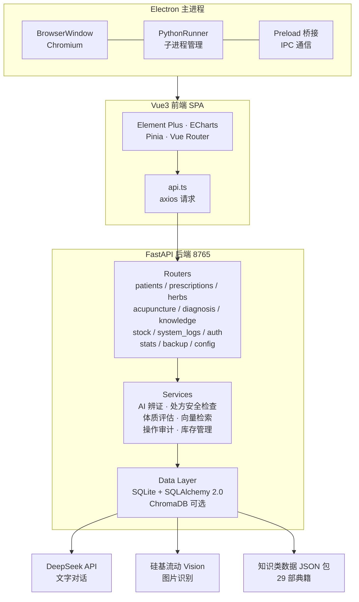

# 中医诊所管理平台 (tcm-doctor)

以《伤寒论》《金匮要略》与**倪海厦经方体系**为核心的诊所管理平台：从问诊十问辨证，到六经推荐经方、一键开方发药，全流程闭环。

> ⚠️ **免责声明与本项目定位**
>
> - **仅供学习与临床辅助**：AI 辨证与方剂推荐结果仅供参考，不构成诊疗建议；处方须由具备执业资质的医师亲自审核签发。
> - **内容来源**：内置药材、方剂、穴位与医籍内容整理自中医经典文献及倪海厦人纪系列，版权归原作者及出版方所有，仅用于学习研究。
> - **合规提示**：正式临床使用请遵循当地《医疗机构管理条例》《中医病历书写规范》等相关法规。
> - **数据分发**：知识类数据（药材 / 穴位 / 方剂 / 典籍）已独立为可导入的 JSON 数据包，与代码仓库分离、作为 GitHub Release 资产分发（详见[数据分发：基础数据包](#数据分发基础数据包)）。

## 系统架构



## 技术栈

| 层级 | 技术 |
|------|------|
| 桌面壳 | Electron 28 |
| 前端 | Vue 3 + Element Plus + TypeScript + Pinia + ECharts |
| 后端 | Python FastAPI + SQLAlchemy 2.0 + SQLite |
| 权限 | 5 种角色 + 17 个细粒度权限点（见[权限模型](#权限模型)） |
| AI 文字 | DeepSeek API (deepseek-chat / deepseek-reasoner) |
| AI 图片 | 硅基流动 Vision API (Kimi-K2.6) |
| 知识检索 | RAG 多路召回 (关键词 + ChromaDB 语义向量，可降级) |
| 审计 | 全接口操作日志（DEBUG / INFO / WARN / ERROR 四级） |
| 打包 | electron-builder (NSIS) + PyInstaller |

## 快速开始

### 环境要求

- Python 3.12+
- Node.js 18+
- npm

### 方式一：一键启动（推荐）

```bash
git clone https://github.com/acuherb/tcm-doctor.git
cd tcm-doctor
chmod +x start.sh
./start.sh
```

脚本会自动完成：检查依赖 → 安装前后端依赖 → 建表并初始化管理员账号 → 同时拉起后端 (8765) 与前端 (5173)。

浏览器访问 `http://localhost:5173`。首次登录请使用初始化生成的管理员账号，进入「系统设置」配置 DeepSeek API Key 即可启用 AI 辨证。

### 方式二：手动启动

```bash
# 1. 安装后端依赖
cd backend
pip install fastapi uvicorn sqlalchemy pydantic-settings httpx python-multipart

# 2. 安装前端依赖
cd ../frontend
npm install

# 3. 启动后端（端口 8765）
cd ../backend
python -m uvicorn app.main:app --reload --port 8765

# 4. 新开终端，启动前端（端口 5173，自动代理 /api → 后端）
cd frontend
npm run dev
```

> **生产部署提示**：后端登录限流为进程内内存计数，**必须单 worker 运行**（不要使用 `--workers N`），否则暴力破解防护会失效。建议置于反向代理后并启用 HTTPS。

### API Key 配置

| 配置项 | 说明 | 示例 |
|--------|------|------|
| API Key | DeepSeek 对话模型密钥 | `sk-xxx` |
| 对话模型 | 纯文字对话使用的模型 | `deepseek-chat` |
| Base URL | DeepSeek API 地址 | `https://api.deepseek.com` |
| Vision 模型 | 图片识别模型（第三方） | `Pro/moonshotai/Kimi-K2.6` |
| Vision URL | Vision API 地址 | `https://api.siliconflow.cn/v1` |
| Vision Key | Vision API 密钥（留空则复用对话 Key） | `sk-yyy` |

> 图片识别为可选功能。未配置 Vision 时，上传图片不会报错，AI 将基于文字描述进行分析。

### 桌面端打包

> ⚠️ **必须在 Windows 机器上执行**。PyInstaller 不能跨平台交叉编译——在 Linux/macOS 上打包出的后端可执行文件无法在 Windows 上运行，而 `electron-builder.yml` 与 `python-runner.ts` 中的后端路径写死为 `tcm-backend.exe`。

```bash
# 1. 编译 Electron 主进程
cd electron && npx tsc && cd ..

# 2. 构建前端
cd frontend && npm run build && cd ..

# 3. 打包后端为 exe（需先 pip install pyinstaller）
cd backend && python -m PyInstaller build.spec && cd ..

# 4. 生成安装包（需配置国内镜像）
ELECTRON_MIRROR="https://npmmirror.com/mirrors/electron/" \
ELECTRON_BUILDER_BINARIES_MIRROR="https://npmmirror.com/mirrors/electron-builder-binaries/" \
npx electron-builder --win --x64
```

产出：`dist-electron/tcm-doctor-setup-0.1.0.exe`

安装包内**只包含后端可执行文件**，不携带任何数据库或业务数据。数据目录位置：

| 部署形态 | 数据目录 |
|---------|---------|
| 桌面安装（Windows） | `%APPDATA%\tcm-doctor\`（数据库、`.env`、Chroma 向量库） |
| Docker / 容器 | `DATA_DIR` 挂载点（默认 `/data`） |
| 开发模式 | 项目根目录（`backend/tcm_doctor.db`） |

> 桌面端首次启动会在用户目录下自动建库并初始化系统骨架，不会向安装目录写入——避免 `Program Files` 只读导致的启动失败。知识数据不再打进安装包：默认纯框架，需要基础数据请从 GitHub Release 下载数据包后在对应模块工具栏导入。

## 功能模块

### 患者管理
- 患者信息 CRUD + 分页搜索
- 就诊记录（四诊信息 + 辨证论治 + AI 辅助辨证 + 问诊十问 同一页面一体化完成）
- 问诊十问（倪海厦经方家十问，预定义选项 + 自填，按原文判据推出六经/寒热/虚实偏性，随病例持久化）
- 患者档案链（以**就诊时间线为主轴**聚合呈现：每条就诊卡片内联该次的问诊十问 + 四诊辨证 + 处方；历史未关联就诊的十问单独置于底部区块）
- 患者列表多维筛选 + 聚合信号（不动 schema）：按体质 / 标签 / 过敏 / 最近改善筛选；列表展示「最近就诊 / 距今天数（超 30 天标红）/ 最近改善 / 在治·停诊·未复诊 状态 / 过敏·不遵医嘱 风险角标」；窄屏卡片视图同样呈现关键信号
- 患者详情「🩺 健康速览」卡：体质类型 + BMI / 身型 + 过敏史告警（红/绿）+ 标签色块，一眼抓住关键风险
- 病情跟踪「上次开方 → 本次反馈」对比：每张随访卡片关联展示本次反馈所对应的就诊处方（方名 / 疗程 / 剂数 / 味数）

### 药品管理
- 药材字典（229 味，覆盖 18 个分类，支持异名搜索 + 批量导入/导出 JSON）
- **库存管理全景**（独立模块，9 个页面）：
  - 库存总览（预警与总览双卡片、批量操作）
  - 物品管理（增删改查 + 多维筛选）
  - 出入库流水（多维筛选、金额配色区分）
  - 库存盘点（全量 / 抽盘两种模式 + 批次纠错）
  - 采购入库（采购单 + 明细展开）
  - 供应商管理
  - 库存选项（物品类别 + 计量单位维护）
  - 进销存报表（汇总 / 利润 / ABC 分析 / 周转率 / 供应商价格）
- 处方安全检查（仅超剂量 / 毒性 / 孕妇禁忌提醒，按《本经》三品标注）
- **十八反·十九畏校验已完全移除**（代码中仅保留说明性注释，不再做硬性拦截，后续亦无计划恢复）

### 针灸穴位库
- 腧穴字典（170 穴，合并倪师穴位索引 + 针灸 164 项，按十四经 / 任督 / 奇穴归类，带定位详情）
- 穴位增删改查 + 关键词搜索 / 按归经筛选

### 处方管理
- 处方编辑器（经典方导入 → 加减药味 → 煎服法 → 实时安全检查）
- **药方 + 针灸方双区块并列**：一张处方可同时开具中药方与针灸方（也可只开其一），自动判定 `prescription_type`（药方 / 针方 / 混合）
  - 🌿 **中药方**：方名 / 煎法 / 剂数 / 服法 / 药味明细
  - 🪡 **针灸方**：方案名（独立字段 `acupoint_formula_name`，不与中药方名混用）/ 针法 / 操作频次（每日·隔日·每周…）/ 疗程天数（数字）/ 配穴明细（穴位·针法·留针·顺序·备注）
- 处方审核 + 发药 + 库存扣减
- **开方自动生成随访提醒**：填写疗程天数 `treatment_days` 或表单「建议复诊日期」后，自动创建一条待回访提醒（应回访日期 = 就诊日 + 疗程天数，或医生指定日期），用于工作台待办提醒（详见「数据统计」）
- **经典方剂库**（经方全集，支持新增/编辑/删除/导入/导出 JSON，按六经归档）
- **针灸方库**（新增，与经典方库对齐）：把一组穴位按方名固化成可复用针灸方，内置安神定志/健脾和胃/腰痛/疏风解表/调经/醒脑开窍等 6 首针方（来源标注倪海厦·针灸 / 通用）；支持 CRUD + 导入/导出 JSON
  - 「引入到处方编辑器」可一键预填针灸方名 / 针法 / 频次 / 疗程天数 + 全部配穴
  - 处方表通过 `acupoint_formula_id` 关联针灸方库（与 `classic_formula_id` 对称）
- 辨证-选方联动（问诊十问辨证结果 → 推荐对应经方 → 一键导入开方，形成闭环）
- 处方列表 / 详情弹窗 / 打印模板均完整展示中药方与针灸方（列表新增「针灸方」列；打印中剂数/煎法/服法归属中药方区块，置于针灸方之前）

### AI 智能问诊
- 对话式问诊（DeepSeek + RAG 知识库增强）
- 四诊辨证分析（结构化四诊输入 + AI 综合辨证）
- 图片识别（舌苔照片/面色/化验单/影像报告 → AI 读取分析）
- 中西医结合（西医病名/化验指标 → 中医辨证 + 中西医结合治疗方案）
- 安全硬约束（配伍禁忌 + 孕妇禁忌 + 毒性药自动检测）

### 知识库
- 医籍文库（29 部中医经典，1313 条知识条目）
- 知识检索（关键词 + 语义向量双路检索）
- 经典方剂数据（伤寒论/金匮要略/温病条辨等出处方剂）

### 数据统计
- 工作台仪表盘（统计卡片 + 7 日就诊趋势 + 库存预警 + 待办【含「📞 待回访」提醒：逾期/到期患者应回访，列表直达患者详情】）
- 统计报表（就诊趋势/用药分析/处方统计 ECharts 图表）

### 系统管理
- 系统设置（API 配置 + 连接测试 + 持久化到 .env）
- **账号管理**（用户增删改查、显示名称、角色分配、启用 / 禁用、自定义权限点）
- **操作日志**（全接口审计，见下节）
- 数据备份/恢复（SQLite 导出/导入/重置，仅 `backup:manage` 权限）

#### 界面风格（主题）

提供 4 套预设配色，可在右上角账号菜单「界面风格」中随时切换：

| 主题 | key | 主色 | 风格 |
|------|-----|------|------|
| 本草 | `herbal` | `#8B4513` 深褐 | 暖褐 + 金，默认风格 |
| 墨色 | `ink` | `#2F4858` 墨青 | 冷灰蓝，沉静克制 |
| 朱砂 | `vermilion` | `#A0362A` 朱砂红 | 传统红调，醒目 |
| 青玉 | `jade` | `#4A7C59` 青玉绿 | 草木绿，柔和 |

**同步机制**：主题写入系统配置（`PUT /api/v1/config` 的 `ui_theme` 字段）并持久化到 `.env`，**同一诊所所有终端登录后自动统一**。非管理员切换仅本机生效，不影响全局。

**扩展新主题**：在 `frontend/src/styles/tcm-theme.scss` 增加一个 `[data-theme="xxx"]` 块，声明 `--tcm-primary` / `--tcm-sidebar-*` / `--tcm-bg` / `--tcm-login-bg-*` 等变量，并在 `frontend/src/utils/theme.ts` 的 `THEMES` 中登记元数据即可，无需改动任何组件。组件配色统一取自 CSS 变量，Element Plus 主色也已映射到 `--tcm-primary`，会自动跟随。

> 语义色（BMI 分级、库存预警、处方状态、君药标记）**不随主题变化**；打印/导出样式固定为褐色，确保单据外观稳定。
> 图表（ECharts）无法读取 CSS 变量，通过 `onThemeChange` 订阅在切换后重新取色并 `setOption` 重绘。

#### 权限模型

系统采用 **5 种角色 + 17 个细粒度权限点**，管理员可为任意账号单独勾选权限点（自定义权限优先于角色模板）。

| 角色 | 说明 | 典型权限 |
|------|------|----------|
| `admin` | 管理员 | 全部权限，含账号管理与备份 |
| `doctor` | 医师 | 患者、就诊、处方读写，AI 辨证 |
| `pharmacist` | 药师 / 药房 | 库存、发药，**不可开方** |
| `viewer` | 只读 | 仅查看，所有写操作与导出被拒 |
| `custom` | 自定义 | 由管理员逐项勾选 |

> **游客登录**：`ALLOW_GUEST_LOGIN` **默认关闭**（`false`）。如需临时演示，可在 `.env` 中显式开启，此时游客仅能浏览，所有导出 / 写接口在后端返回 403，前端同步隐藏全部导出入口，防止患者隐私（PII）泄露。

#### 操作日志

所有经过后端的请求统一记录到 `operation_logs` 表，用于审计与排障：

| 能力 | 说明 |
|------|------|
| 分级 | `DEBUG` / `INFO` / `WARN` / `ERROR`，按 HTTP 状态码与异常自动归类 |
| 内容 | 操作人、角色、方法、路径、操作对象、状态码、IP、耗时、时间 |
| 对象提取 | 自动从请求体提取对象名称（患者姓名 / 药名 / 方名 / 穴名 / 账号 / 供应商等），敏感字段（密码、身份证、手机号、token）自动脱敏 |
| 过滤 | 按操作人、方法、等级、时间区间、关键词检索 |
| 导出 | CSV 导出（受 `log:export` 权限控制） |
| 清理 | 支持一键清空（`DELETE /system/logs/clean`） |

> 日志通过 `BackgroundTask` 异步落库，**对接口响应耗时无影响**；默认保留 180 天，超期自动清理防止表膨胀。

## 数据概况

> 下表为**完整数据安装后**的数量。当前版本默认**纯框架**，不随代码内置知识数据；需要基础数据请从 GitHub Release 下载数据包，在对应模块工具栏导入（见[数据分发：基础数据包](#数据分发基础数据包)）。

| 数据类别 | 数量 |
|----------|------|
| 药材 | 229 味（18 个分类） |
| 经典方剂 | 146 首（伤寒论 112 + 金匮要略 + 后世方，0 缺失，六经归档） |
| 针灸方库 | 6 首（安神定志 / 健脾和胃 / 腰痛 / 疏风解表 / 调经 / 醒脑开窍，来源标注倪海厦·针灸 / 通用） |
| 穴位 | 170 穴（倪师穴位索引 + 针灸 164 项，按归经/奇穴归类） |
| 处方安全检查 | 超剂量 / 毒性 / 孕妇禁忌（**十八反·十九畏已移除**） |
| 知识库条目 | 1313 条 |
| 知识库来源 | 29 部中医经典 |

### 知识库收录典籍

| 类别 | 典籍 |
|------|------|
| 经典 | 伤寒论、金匮要略、黄帝内经·素问、黄帝内经·灵枢、温病条辨 |
| 专科 | 傅青主女科、妇人大全良方、脾胃论、丹溪心法 |
| 针灸 | 中医针灸学、针灸甲乙经 |
| 医案 | 临证指南医案、黄煌经方医案、岳美中医案集、蒲辅周医案、经方实验录 |
| 综合 | 医学衷中参西录 |

## 数据分发：基础数据包

> 默认交付为**纯框架**，不含任何临床知识数据。需要基础数据的用户，从 **GitHub Release 资产**下载官方整理的基础数据包，在对应模块的**工具栏**一键导入即可。

### 为什么要拆

知识类数据（药材、穴位、方剂、典籍）具有三个特点：体量大、更新频繁、有明确的版权归属。将其与业务代码捆绑会带来三个问题：

1. **仓库膨胀**——典籍全文与方剂数据占据绝大部分仓库体积；
2. **版权边界模糊**——整理自倪海厦人纪及中医经典的内容随代码分发，授权范围难以界定；
3. **schema 耦合**——药材表新增字段（如毒性等级）会导致旧数据包整体失效。

因此数据**与代码分离**：源码仓库与安装包默认只含系统骨架，知识数据以**独立的基础数据包**形式，作为 GitHub Release 资产分发。

### 两种获取形态

| 形态 | 适用 | 说明 |
|------|------|------|
| **纯框架** | 已有自建药材库 / 方库的诊所，或想完全自行掌控数据的开发者 | 仓库与安装包均不含知识数据，仅含系统骨架（账号、字典、权限） |
| **基础数据包** | 新开诊所、快速上手 | 从 GitHub Release 下载官方 JSON 数据包，在模块工具栏「上传导入」开箱即用 |

### 入口在哪（重要）

导入 / 导出**不在「系统设置」页**，而是分散在各内容模块的**顶部工具栏**，就地操作：

- 药材字典、中药方库、针灸方库、穴位、知识库 五个页面，工具栏均提供「导出当前 / 上传导入 / 导入内置」按钮（仅管理员可见）；
- **上传导入**：选择本地 JSON 数据包文件批量导入；
- **导入内置**：仅当随安装包附带了内置数据时才显示（GitHub 源码克隆版通常没有，请改用「上传导入」）。

### 基础数据包布局（发行包约定 · 规划中）

若将来制作**发行包**，按**依赖关系**分层（而非按业务类别平铺，避免方剂引用药材时悬空）：

```
templates/
├── manifest.json          # 清单：版本 / 来源 / 条目数 / sha256 / 依赖
├── core/                  # 药材 + 穴位 + 基础字典（必装，体积小）
├── formulas/              # 中药方库 + 针灸方库（依赖 core）
└── books/                 # 医籍文库（体积最大，可选）
```

每个数据包配一份 `manifest.json`，声明 `schema_version`（防止结构漂移）、`sha256`（防止传输损坏）、`depends_on`（防止引用悬空）。完整清单字段与编写说明见 [`templates/README.md`](templates/README.md)，可直接以 [`templates/manifest.example.json`](templates/manifest.example.json) 为模板。

### 导入约束

- **仅白名单表**——数据包只含参考知识，`patients`、`prescriptions`、`stock_batches` 等业务数据**永不打包**，避免误冲用户数据；
- **幂等 upsert**——按唯一键（药名 / 穴名 / 方名）增量写入，重复导入不产生重复数据；
- **预检确认**——导入前先 `dry_run` 输出「新增 N / 更新 M / 跳过 K」，由用户确认后才真正落库，避免误选文件或导错模块污染知识库；
- **与整库恢复隔离**——数据包导入面向「补充知识」，备份恢复（`系统管理 → 数据备份`）面向「灾难还原」，两条路径互不复用。

> 大体积数据包建议采用 **JSONL**（每行一个对象）存储，便于流式解析与定位错误行；小包可用普通 JSON。

## 项目结构

```
tcm-doctor/
├── electron/                # Electron 主进程
│   ├── main.ts             # 窗口管理 + 后端启动
│   ├── preload.ts          # 安全桥接
│   ├── python-runner.ts    # Python 子进程管理
│   └── tsconfig.json
├── frontend/                # Vue3 前端
│   ├── src/
│   │   ├── layouts/        # 主布局（侧边栏导航）
│   │   ├── views/          # 页面组件
│   │   │   ├── dashboard/  # 工作台 + 统计报表
│   │   │   ├── patient/    # 患者列表/详情/就诊记录/体质评估
│   │   │   ├── herb/       # 药材字典
│   │   │   ├── prescription/ # 处方列表/编辑器 + 经典方库
│   │   │   ├── acupoint/   # 穴位 + 针灸方库
│   │   │   ├── knowledge/  # 知识检索 + 医籍文库
│   │   │   ├── inventory/  # 库存总览/物品/流水/盘点/采购/供应商/选项/报表
│   │   │   ├── dictionary/ # 数据字典维护
│   │   │   ├── system/     # 账号管理 + 操作日志
│   │   │   └── settings/   # 系统设置
│   │   ├── components/     # 公共组件（药材选择器/配伍警报）
│   │   ├── utils/          # api.ts（axios 封装）
│   │   └── styles/         # 中医暖色主题（tcm-theme.scss 统一页面骨架）
│   └── vite.config.ts
├── backend/                 # FastAPI 后端
│   ├── app/
│   │   ├── main.py         # FastAPI 入口 + CORS + 审计中间件
│   │   ├── config.py       # pydantic_settings 配置管理
│   │   ├── database.py     # SQLAlchemy 引擎 + 会话
│   │   ├── migrations.py   # 轻量迁移（自动补列）
│   │   ├── permissions.py  # 角色模板 + 17 个权限点定义
│   │   ├── models/         # ORM 模型（患者/就诊/药材/方剂/知识/库存/日志）
│   │   ├── schemas/        # Pydantic 请求/响应模型
│   │   ├── routers/        # API 路由（patients/prescriptions/herbs/acupuncture/
│   │   │                   #   diagnosis/knowledge/stock/auth/system_log/
│   │   │                   #   stats/backup/config 等）
│   │   ├── services/       # 业务逻辑
│   │   │   ├── ai_diagnosis_service.py   # AI 辨证（DeepSeek + Vision + RAG）
│   │   │   ├── incompatibility_checker.py # 处方安全检查（超剂量/毒性/孕妇禁忌）
│   │   │   ├── constitution_evaluator.py  # 问诊十问/六经辨证评估
│   │   │   ├── operation_log.py           # 操作日志写入与对象提取
│   │   │   └── vector_store.py            # ChromaDB 向量检索（可降级）
│   │   ├── data/           # 内置知识数据（后续将独立为数据包）
│   │   └── seed.py         # 首次启动种子初始化
│   ├── run.py              # PyInstaller 入口
│   ├── build.spec          # PyInstaller 配置
│   ├── tcm_doctor.db       # SQLite 数据库（运行时生成，已 .gitignore）
│   └── pyproject.toml
├── resources/               # 应用图标
├── start.sh                 # 一键启动脚本
├── electron-builder.yml     # electron-builder 打包配置
└── package.json             # Electron 根配置
```

## API 端点

| 模块 | 路径 | 说明 |
|------|------|------|
| 系统 | `GET /health` | 健康检查 |
| 系统 | `GET/PUT /api/v1/config` | 系统配置（API Key 持久化，含界面主题 `ui_theme`） |
| 患者 | `/api/v1/patients` | 患者 CRUD |
| 患者 | `/api/v1/patients/{id}/visits` | 就诊记录 |
| 患者 | `/api/v1/patients/{id}/constitution` | 问诊十问 / 体质辨识（支持 `visit_id` 绑定到具体就诊） |
| 药品 | `/api/v1/herbs` | 药材字典 + 详情 |
| 药品 | `/api/v1/herbs/tags/meta` | 药材标签维度与受控词表 |
| 针灸 | `/api/v1/acupuncture` | 穴位字典 + 增删改查 + 导入 |
| 库存 | `/api/v1/stock/items` | 库存物品 CRUD |
| 库存 | `/api/v1/stock/items/{id}/batches` | 批次管理（入库 / 出库 / 报损） |
| 库存 | `/api/v1/stock/transactions` | 出入库流水查询 |
| 库存 | `/api/v1/stock/overview`、`/api/v1/stock/alerts` | 库存总览与预警 |
| 库存 | `/api/v1/stock/adjust/bulk` | 批量校准 |
| 库存 | `/api/v1/stock/suppliers` | 供应商管理 |
| 库存 | `/api/v1/stock/purchases` | 采购入库单 |
| 库存 | `/api/v1/stock/lookup` | 物品 / 单位 / 类别选项 |
| 库存 | `/api/v1/stock/options` | 物品类别与计量单位维护 |
| 库存 | `/api/v1/stock/report/*` | 进销存报表（汇总 / 利润 / ABC / 周转 / 供应商价格） |
| 处方 | `/api/v1/prescriptions` | 处方 CRUD + 审核 + 发药（含 `acupoint_formula_name` / `acupoint_technique` / `treatment_frequency` / `treatment_days` 四个针灸方顶层字段） |
| 处方 | `/api/v1/prescriptions/classic-formulas` | 经典方剂库 |
| 处方 | `/api/v1/acupoint-formulas` | 针灸方库 CRUD（搜索 / 出处筛选 / 导入 / 导出） |
| 处方 | `/api/v1/acupoint-formulas/{id}` | 针灸方详情（供处方编辑器引入预填） |
| 问诊 | `POST /api/v1/diagnosis/chat` | 对话式智能问诊 |
| 问诊 | `POST /api/v1/diagnosis/analyze` | 四诊辨证分析 |
| 问诊 | `POST /api/v1/diagnosis/upload-image` | 上传诊断图片 |
| 问诊 | `GET /api/v1/diagnosis/status` | AI 服务状态 |
| 知识 | `/api/v1/knowledge/search` | 知识检索 |
| 知识 | `/api/v1/knowledge/entries` | 知识条目管理 |
| 知识 | `/api/v1/knowledge/sources` | 知识来源列表 |
| 统计 | `/api/v1/stats/dashboard` | 工作台数据（含待回访 `pending_followups` / `followup_reminders`） |
| 统计 | `/api/v1/stats/visits` | 就诊统计 |
| 随访 | `/api/v1/followup-reminders` | 随访提醒列表 / 创建（手动） |
| 随访 | `/api/v1/followup-reminders/{id}` | 随访提醒更新（标记完成·取消·改期）/ 删除 |
| 备份 | `/api/v1/backup/export` | 导出备份 |
| 备份 | `/api/v1/backup/import` | 导入恢复 |
| 备份 | `POST /api/v1/backup/reset` | 重置数据库（仅 admin） |
| 账号 | `/api/v1/auth/login`、`/logout`、`/me` | 登录 / 登出 / 当前用户 |
| 账号 | `/api/v1/auth/users` | 账号 CRUD（管理员） |
| 账号 | `/api/v1/auth/permissions` | 权限点与角色模板元数据 |
| 审计 | `GET /api/v1/system/logs` | 操作日志查询（分页 + 多维过滤） |
| 审计 | `GET /api/v1/system/logs/meta` | 筛选项元数据（操作人 / 方法 / 等级） |
| 审计 | `GET /api/v1/system/logs/stats` | 日志统计 |
| 审计 | `GET /api/v1/system/logs/export` | CSV 导出 |
| 审计 | `DELETE /api/v1/system/logs/clean` | 清空日志 |

## 开发模式启动

```bash
./start.sh            # 前后端开发模式（后端 :8765 + 前端 vite）
./start.sh electron   # Electron 桌面壳开发模式

# 或手动（项目根目录）
npm install           # 根依赖（concurrently / electron / typescript）
cd frontend && npm install && cd ..
cd backend && python3 -m pip install -e ".[ai]"   # 含 chromadb / openai
npm run dev           # 同时启动后端 uvicorn 与前端 vite
```

> 首次运行若缺少 `backend/.env`，脚本会生成默认开发配置；将 `DEEPSEEK_API_KEY` 填入即可启用 AI 辨证。
> 后端 API 文档：http://127.0.0.1:8765/docs

## Docker 容器部署（群晖 Container Manager / 服务器）

生产部署使用**单镜像**（内置前端静态产物 + FastAPI 后端，由 FastAPI 直接托管页面），所有持久化数据统一落在容器内的 `/data` 目录，挂载宿主机目录即可在删容器重建后保留数据。

### 1. 构建并导出镜像（在有 Docker 的构建机上）

```bash
cd tcm-doctor
docker build -t tcm-doctor:latest .
docker save tcm-doctor:latest -o tcm-doctor-image.tar
```

> 多阶段构建：前端用 `node:20-alpine` 构建 `dist`，后端用 `python:3.12-slim` 运行；镜像约 60–70MB，无需在宿主机装 Node/Python。

### 2. 群晖 Container Manager 导入并运行

- `映像 → 操作 → 导入 → 从文件`，选择 `tcm-doctor-image.tar`。
- 选中镜像 → **运行**，在向导里配置：
  - **端口**：本地 `8765` → 容器 `8765`（TCP）。务必手动指定，勿用随机端口，否则外网/反代会连错。
  - **卷（关键）**：本地目录（如 `docker/tcm-data`）→ 容器 `/data`。数据库与 `.env` 配置都在此，挂载后**删容器重建也不丢数据**。
  - 环境变量（可选）：`PORT`（默认 8765）、`DATA_DIR`（默认 `/data`）、`ALLOW_GUEST_LOGIN`（**默认 `false` 关闭**，需要游客浏览时显式设为 `true`）。

### 3. 首次启动

- 容器启动后自动建表，并初始化内置知识数据（药材 229 味、经典方 146 首、穴位 170、知识库 1313 条）与管理员账号，首次约需 10–20 秒。
  > 当前默认即为「空框架 + 按需导入 JSON 数据包」：首次启动只建表并创建管理员账号，知识数据从 GitHub Release 下载后于模块工具栏导入。
- 浏览器访问 `http://<主机IP>:8765`，默认账号 `admin / admin123`（**首次登录请立即改密**）。
- 「系统设置」填入 DeepSeek API Key 即启用 AI 辨证。

### 4. 更新镜像（保留数据）

> 重要：更新前先在**「系统管理 → 数据备份 → 导出」**下载备份文件，以防万一。

1. 群晖删除旧 `tcm-doctor` 容器与旧映像；
2. 重新导入新 `tcm-doctor-image.tar` 并运行（**保持同样的 `/data` 卷映射**）；
3. 如需恢复历史数据，「系统管理 → 数据备份 → 导入」选备份文件即可。

### 5. 外网访问（群晖反代 / Cloudflare）

- 先内网直连 `http://<群晖IP>:8765` 确认应用本身正常；
- 若经反向代理或 Cloudflare（如 `tcm.xxx.xyz`）出现 **502 Bad Gateway**，通常是反代「目标端口」没指向群晖主机的 `8765`——把反代目标主机设为 `127.0.0.1`、目标端口设为 `8765` 即可。

## 脚本说明（一次性 / 种子）

后端 `backend/` 目录下存在若干**一次性数据处理脚本**，它们不参与应用常规运行，仅用于历史数据导入或校验，**不要**当作常驻入口：

| 脚本 | 用途 | 状态 |
| --- | --- | --- |
| `seed_acupoints.py` / `seed_dictionaries.py` | 主数据（腧穴 / 字典）种子，**已接入** `app/seed.py` 的 `seed_all()`，随应用启动自动增量导入 | ✅ 常驻可用 |
| `seed_nihaixia.py` | 导入倪海厦经方体系数据（一次性） | ⚠️ 一次性，已并入主库后无需再跑 |
| `_seed_formulas.py` / `_seed_jingfang.py` | 早期经典方 / 经方导入（一次性） | ⚠️ 一次性，已被 `app/data/classic_formulas.json` 取代 |
| `seed_posts.py` | 导入文章/帖子演示数据（一次性） | ⚠️ 一次性 |
| `_check_herbs_coverage.py` | 校验药材数据覆盖率（诊断用） | ⚠️ 诊断/校验工具 |
| `app/data/generate_herbs.py` / `generate_knowledge.py` | 由原始数据生成 `herbs.json` / 知识库 JSON（构建期工具） | ⚠️ 离线生成工具 |

> 应用首次启动由 `app/main.py` 的 lifespan 调用 `app/seed.py → seed_all()` 自动完成建表与种子导入；
> 如手动运行请使用 `python -m app.seed`（在 `backend/` 目录下），它会自动建表并幂等导入，不会清空既有数据。

## 已知限制

以下为当前版本**明确未实现**的能力，使用前请评估是否可接受：

| 类别 | 现状 | 影响 |
|------|------|------|
| 收费与结算 | 无诊疗收费、处方划价、支付记录、日报对账 | 收费需线下另行记录 |
| 挂号与排班 | 无挂号、候诊队列、医生排班、叫号 | 多医生坐诊时需纸质辅助 |
| 处方防篡改 | 处方可修改且不保留历史版本 | 无法自证处方未被事后更改 |
| 病历电子签名 | 无医师资质证书号与签名留痕 | 处方笺项目可能不满足规范要求 |
| 备份加密 | 备份为明文 SQLite 文件，且仅支持手动导出 | 备份文件外流即等同于患者信息泄露 |
| 会话管理 | 令牌有效期 30 天，无强制下线 / 在线会话列表 | 账号异常时需删库令牌 |
| 并发控制 | 无乐观锁版本号 | 多人同时编辑同一记录会相互覆盖 |
| 语义检索 | `ENABLE_SEMANTIC_SEARCH` 默认关闭 | 未开启时仅关键词精确匹配 |
| AI 成本统计 | 无 token 消耗与费用统计 | 无法预估 API 账单 |

> **部署必读**：后端登录限流为进程内内存计数，**必须单 worker 运行**；SQLite 适合单诊所（数个并发用户）场景，不建议多人高并发使用。

## 致谢

本项目基于 [OMDOCTOR](https://github.com/sunshengzhuo/OMDOCTOR) 进行二次开发，感谢原作者 [@sunshengzhuo](https://github.com/sunshengzhuo) 提供的优秀开源基础。